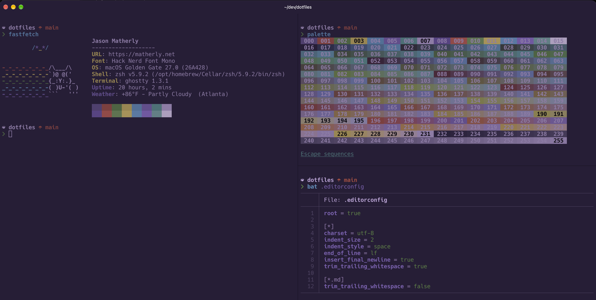

# ~jason 🛠️

Jason's personal dotfiles for configuring macOS with Zsh and mise — a personalized fork of [nicksp/dotfiles](https://github.com/nicksp/dotfiles).



> [!WARNING]  
> These are personal, opinionated dotfiles. Review `tilde/.config/mise/conf.d/20-macos.toml`, `setup/macos-extras.sh` and `tilde/.config/mise/conf.d/30-packages.toml` before running them on a new machine.

## Requirements

- macOS on Apple Silicon (mise installs formulae and casks into `/opt/homebrew`; Homebrew itself isn't needed); the macOS defaults were reviewed for macOS 27
- Zsh — the `brew:zsh` package; mise makes it your login shell (`[bootstrap.user]`)

Installing on a new Mac with mise alone has not been run end to end on a clean Mac yet.

## What's in there?

- Custom color scheme: [Squirrelsong](colors/).
- Handy [CLI scripts](bin/).
- [`sysup`](bin/sysup): one command to update macOS, mise and its packages, runtimes and the rest (see [Updating](#updating)).
- Coding agents [config automation](agents/): shared instructions for Amp and Codex, plus Claude Code's plugins, settings and skills, restored by setup along with a catalog of everything installed, and opt-in per-repo [Hindsight](https://github.com/vectorize-io/hindsight) memory for Claude Code and Codex (`hindsight-memory`).
- [Custom zsh theme](tilde/.starship.toml) with Git status, etc. using [Starship](https://starship.rs/).
- Runtime versions (Node, Python, etc.) managed by [mise](https://mise.jdx.dev/), activated in [`tilde/.zprofile`](tilde/.zprofile) (shims, for GUI apps) and [`zsh/init.zsh`](zsh/init.zsh) (full shell integration).
- [Git aliases](tilde/.gitconfig), with identity/signing configured per-machine via `~/.gitconfig.local` (see [Local customizations](#local-customizations)) — commit signing via SSH through 1Password, or GPG.
- [Zsh aliases](zsh/aliases.zsh).
- [Obsidian](obsidian/) setup — settings, theme, plugins, templates and Bases views — installed into the iCloud Drive → Notes vault with `obsidian-vault install` (see [first-time setup](obsidian/README.md#first-time-setup)).
- [fzf](zsh/fzf.zsh) in Zsh: fuzzy history, file and directory pickers with previews.
- [hunk](https://github.com/modem-dev/hunk) as the terminal diff viewer for git, lazygit and gh.
- Sensible [macOS defaults](tilde/.config/mise/conf.d/20-macos.toml), declared as TOML that mise applies and checks for drift.
- [VS Code settings](vscode/), symlinked from the repo (VS Code's built-in Settings Sync stays off — the dotfiles are the source of truth).
- [Firefox Developer Edition styles](firefox/) (optional — the browser isn't in `30-packages.toml`).
- Terminal config for [Ghostty](tilde/.config/ghostty/) and [cmux](tilde/.config/cmux/), and for the tools in them: bat, btop, fastfetch, gh, lazygit.
- [Fonts](fonts/README.md): Hack Nerd Font Mono in the terminals (Ghostty, cmux, fastfetch) and Iosevka Code in VS Code. The Nerd Fonts are casks in `30-packages.toml`; Iosevka Code has no cask, so `bin/install-iosevka-code` installs it. [MonoLisa](https://www.monolisa.dev/) is an optional paid font you install by hand.
- [Command-line tools, macOS apps and VS Code extensions](tilde/.config/mise/conf.d/30-packages.toml) I use, installed by mise.
- [macOS tips & tricks](docs/macos%20tips%20%26%20tricks.md).
- [Mole](docs/mole.md) (`mo`) cleanup guide, with its whitelists tracked in [`mole/`](mole/) and a per-Mac `.local` override.
- [REA](docs/rea.md), the reverse-engineering MCP server and CLI: how it is installed and registered, which engines work on this Mac, and how to check.
- [jstack](docs/jstack.md), the Claude Code plugin that holds my working habits as skills: j-mode, the playbooks, the principles and the band above the prompt.
- Built-in help: `help` shows the [alias index](docs/README.md), `help <command>` documents any script in `bin/`, and `help gui/<app>` shows [shortcut cheat sheets](docs/gui/) for GUI apps.

## Installation

On a new Mac, clone over HTTPS — SSH only works after 1Password is set up (keys live there, see [`~/.ssh/github_personal.pub`](#sshgithub_personalpub)).

1. Install the Command Line Tools (for `git`):

   ```shell
   xcode-select --install
   ```

1. Clone the repo (no GitHub login needed; `setup/misc.sh` offers `gh auth login` later, and setup only warns when gh has no token, see [Run setup](#run-setup)):

   ```shell
   git clone https://github.com/jrmatherly/dotfiles.git ~/dev/dotfiles
   ```

   Setting up your own Mac? Fork the repo, clone your fork instead, and go through [Make it yours](#make-it-yours) before running setup.

1. Optional, for signed commits from the start: install 1Password (download it: mise isn't installed until `./setup.sh` runs), sign in and turn on **Settings → Developer → Use the SSH agent**. `setup/dotfiles-extras.sh` asks how to sign commits — [SSH via 1Password](https://www.1password.dev/ssh/git-commit-signing) (`op-ssh-sign`; paste your public key when asked), GPG, or none — and writes `~/.gitconfig.local`. Choose none if 1Password isn't ready yet and add signing to `~/.gitconfig.local` later.
1. [Run setup](#run-setup). To see first what it would do, see [Preview](#preview).
1. Finish the steps setup can't do for you: see [After setup](#after-setup).

The repo can live anywhere — the scripts resolve their own location, and `~/.zshenv` exports it as `$DOTFILES`. `setup.sh` also creates a `~/dotfiles` symlink pointing at the clone, for the few configs that can't expand variables (e.g. lazygit's `shellFunctionsFile`).

### Run setup

To automate the setup of your dotfiles on a new machine, use the [setup](./setup.sh) script.

> [!CAUTION]  
> Use at your own risk!

```shell
~/dev/dotfiles/setup.sh # after cloning as in step 2 above
```

`setup.sh` is a thin wrapper around [`mise bootstrap`](https://mise.jdx.dev/bootstrap.html). In order, it:

1. checks for the Command Line Tools, and stops with the install command when they are missing
1. links `~/dotfiles` to the clone and `~/.config/mise` to the clone's mise config, and stops when something else is at either path
1. installs mise into `~/.local/bin` when it is missing
1. links the dotfiles into your home directory, before any package can put a file where a link belongs
1. installs the formulae and casks
1. runs `mise bootstrap`: Touch ID for `sudo` and the login shell
1. installs the runtimes and CLIs with `mise install`
1. runs [`setup/misc.sh`](setup/README.md#misc), the `bootstrap` task, for everything else
1. installs the VS Code extensions
1. runs [`setup/dotfiles-extras.sh`](setup/README.md#dotfiles-extrassh)

A package or tool that fails to install only warns, and the run goes on. The last thing on screen is then a list of what failed, with mise's reason when it printed one, and `setup.sh` exits 2 instead of 0. A tool's reason can be cut short: `mise install <tool>` from `~` shows the whole error. Anything else that fails, such as a part of `mise bootstrap` or the task, stops the run with exit status 1 and the earlier steps stay applied: fix what it reported and run `./setup.sh` again. Every step is safe to repeat, and rerunning `./setup.sh` is also how you apply later changes. Use it rather than a bare `mise bootstrap`, which also applies the macOS preferences and restarts Finder and the Dock. Setup never applies those: [`set-defaults`](#set-macos-defaults) does.

It exports telemetry opt-outs (.NET, PowerShell, Azure CLI, Azure MCP server, Azure Functions Core Tools, Aspire, CodeGraph, rtk, Claude Code error reports) before any of those tools is installed.

Everything is then configured by editing files in the clone. For a diagram of what it runs, what it downloads and what needs `sudo`, see [setup/README.md](setup/README.md#setupsh-wrapper).

Options:

| Flag | Effect |
| --- | --- |
| `-y`, `--yes` | Don't wait for confirmation before starting, and pass `--yes` to mise |
| `--skip-codegraph` | Don't install [CodeGraph](https://github.com/colbymchenry/codegraph) or connect it to Claude Code (an existing install is left alone) |
| `--dash` | Also run the optional [Dash docset setup](setup/dash.sh) |
| `-h`, `--help` | Print usage and exit |
| `-- <args>` | Pass the rest to `mise bootstrap`. `./setup.sh -- --skip packages` leaves the packages alone, `-- --upgrade` also upgrades the packages and tools, `-- --dry-run` previews. A `--skip` list is merged with the `macos-defaults` setup always skips. `--only` is refused: run `mise bootstrap --only <parts>` from `~` instead |

Along the way it prompts for your git identity and commit signing (`~/.gitconfig.local`), asks for your password once more when mise changes the login shell (`chsh` does not use sudo), and offers to run `gh auth login` if the GitHub CLI isn't authenticated yet. A real file or folder where a link belongs stops the run: `mise dotfiles apply` names every such path and writes nothing. Move it aside, or adopt it with `mise dotfiles add <path>` (your file then replaces the tracked one, so check `git diff`), and run again. There is no prompt. `mise dotfiles apply --force` replaces the file with no backup. A link that points somewhere else is repointed without asking.

mise declares `/etc/pam.d/sudo_local`, which enables Touch ID for `sudo` (content, mode, owner `root:wheel`), and rewrites it when any of them differs.

Tap formulae resolve through GitHub's API. mise asks `gh` for a token itself, and `setup.sh` only warns when `gh` isn't signed in and `MISE_GITHUB_TOKEN` is unset. The anonymous limit is 60 calls an hour: one run fits, a second within the hour may not (two runs and a `mise bootstrap packages status` used all 60 on a new Mac). If packages fail to resolve, run `gh auth login` and rerun `./setup.sh`.

### Preview

To see what a run would do on a Mac that has mise but not the `~/.config/mise` link:

```shell
cd ~ && MISE_CONFIG_DIR=~/dev/dotfiles/tilde/.config/mise mise bootstrap --dry-run --skip macos-defaults
```

It changes nothing. `./setup.sh -- --dry-run` previews through the wrapper instead, but it still makes the two links and installs mise.

### After setup

Setup leaves these to you:

1. Open a new terminal, so the shell picks up the new config and `$DOTFILES/bin` is on PATH.
1. Set up GitHub SSH through 1Password: add your key's public half to GitHub, save it as [`~/.ssh/github_personal.pub`](#sshgithub_personalpub), check with `ssh -T git@github.com`, and optionally switch the clone to SSH: `git remote set-url origin git@github.com:jrmatherly/dotfiles.git`.
1. Apply the macOS defaults: [`set-defaults`](#set-macos-defaults).
1. In VS Code, run **SpaceBox Enable UI Enhancer** from the Command Palette, then quit and reopen VS Code. The blur settings do nothing until then, and the step is needed again after each VS Code update (see [vscode](vscode/README.md#spacebox-ui-enhancer)).
1. Install the Obsidian vault settings: [`obsidian-vault install`](#set-up-the-obsidian-vault).
1. Import the color themes that apps can't read from the repo: [`install-color-themes`](#install-color-themes).

## Extras

### Set macOS defaults

```shell
set-defaults
```

Applies the preferences declared in [`20-macos.toml`](tilde/.config/mise/conf.d/20-macos.toml) with `mise bootstrap macos defaults apply`, which lists the planned writes and asks first, then runs [`setup/macos-extras.sh`](setup/macos-extras.sh) for what TOML can't express. See [what it changes](setup/README.md#macos). Nothing prompts any more. The choices the old script asked about are switches in the "macOS (this Mac)" section of [`dotfiles-settings`](settings/README.md): the screenshot, Time Machine new-disk, TextEdit and Software Update groups, the firewall with stealth mode, and turning Time Machine off (all on unless you switch them off), and HiDPI and the computer name (off or empty unless you set them; `set-defaults --hidpi` and `--computer-name "Name"` do the same for one run). **By default `set-defaults` turns Time Machine backups off.** If this Mac (or your fork) uses Time Machine, run `dotfiles-settings set macos.disable_time_machine off` before the first `set-defaults`; the same applies to a plain `mise bootstrap` run by hand. The rest are tables in the git-ignored `config.local.toml`. `mise bootstrap macos defaults status` shows which preferences have drifted. mise never deletes a preference, never uses sudo for one and doesn't restart apps by itself, so the extras script force-quits Finder, Dock, Activity Monitor, Notification Center, SystemUIServer and Terminal (Terminal is spared when you run it from Terminal.app). Log out afterwards so key repeat takes effect. Safari isn't configured by it; set Safari up in Safari → Settings.

### Use alternative apps icons

Refer to the [icons documentation](icons/README.md) for available icon variants.

### Install color themes

```shell
install-color-themes
```

The [Squirrelsong](colors/) theme files are owned by this repo — nothing is downloaded. bat, btop and Ghostty (and cmux) read theirs straight from the repo; the script rebuilds bat's theme cache, prints where to import the Nimble Commander, Syntax Highlight and CotEditor themes, and copies the Obsidian theme into your vault (`$OBSIDIAN_VAULT`) if it exists. To change a theme, edit the file in the repo and commit it.

### Set up the Obsidian vault

```shell
obsidian-vault install # repo → iCloud Drive/Notes (quit Obsidian first)
obsidian-vault capture # bring settings/templates changed in Obsidian back to the repo
```

See [obsidian](obsidian/README.md) for the vault layout and the first-time walkthrough.

### Configure Dash docsets

Dash's built-in Docset Generator (Settings → Downloads → Docset Generator) can index local folders of **HTML** documentation — not Markdown. The paths are machine-specific, so they're configured interactively rather than committed. Docsets you download inside Dash are separate: Dash stores those in `~/Library/Application Support/Dash/DocSets` and syncs the list itself.

```shell
setup/dash.sh                                          # prompts for folder, name, keyword
setup/dash.sh add ~/dev/myapp/docs/html "My App" myapp # or add one directly
```

This edits the repo's Dash sync file, so it only takes effect once Dash's sync folder (Dash → Settings → General) points at the repo's `dash/` folder. Quit Dash before running it.

## Make it yours

Setup already asks for your git identity and commit signing. These values are hard-coded to me, so change them in your fork:

| File | What to change |
| --- | --- |
| `README.md`, [`docs/macos tips & tricks.md`](docs/macos%20tips%20%26%20tricks.md) | Title, intro and the `jrmatherly/dotfiles` clone URL and link |
| [`agents/README.md`](agents/README.md) | The `jrmatherly/skills` links point to my skills repo — use it, your own, or the [skills CLI](https://github.com/vercel-labs/skills) alone |
| [`tilde/.config/fastfetch/config.jsonc`](tilde/.config/fastfetch/config.jsonc) | Name, URL and weather `location` |
| [`lazygit/config.yml`](lazygit/config.yml) | The author name under `authorColors` |
| [`agents/claude-*`](agents/) | My Claude Code plugins, settings and skills, including the `jrmatherly-skills` marketplace (`jstack`, `resume`) and the `coding-standards` and `supabase-prompts` skills from my public skills repo — keep them or drop those lines. Run `claude-config save` once yours are installed and commit the result |
| [`agents/catalog/curated.toml`](agents/catalog/curated.toml) | Notes on my tools. `claude-catalog` still builds but exits 1 (a warning in setup) for each skill, command or agent you don't have installed — delete those. An `[mcp.*]` entry you lack, like my `coolify` server, only prints a `lint:` note, because MCP registration is per machine |
| [`30-packages.toml`](tilde/.config/mise/conf.d/30-packages.toml), and the tools in [`config.toml`](tilde/.config/mise/config.toml) | My formulae, apps and VS Code extensions. Trim them before the first run. The `jrmatherly/tap` entries (`claude-multipass` and its app) are my own projects |
| [`settings/registry.toml`](settings/registry.toml) | `macos.disable_time_machine` and `macos.firewall` default to on, my choice. **If you use Time Machine, run `dotfiles-settings set macos.disable_time_machine off` before `set-defaults`, which otherwise stops all backups.** |
| [`package.json`](package.json) | The `author` field |
| [`setup/bootstrap-runtime.archify.json`](setup/bootstrap-runtime.archify.json) | The `meta.repository.url` clone URL (Archify's source for the setup diagram; the exported SVG doesn't show it) |
| [`LICENSE`](LICENSE) | Add your copyright line; keep the existing ones (MIT requires it) |

[`docs/jstack.md`](docs/jstack.md) and [`docs/gui/raycast.md`](docs/gui/raycast.md) also link my own projects (`jrmatherly/skills`, `jrmatherly/claude-multipass`); they describe tools this setup installs, so keep them unless you drop those tools.

## Local customizations

The dotfiles can be extended to suit additional local requirements by using the following files:

### `~/.zsh.local`

If this file exists, it's sourced near the end of `~/.zshrc` (after `zsh/init.zsh`), so its content can add to or override the existing aliases, settings, PATH, etc.

An `export` here is a starting value. A setting changed with [`dotfiles-settings`](settings/README.md) beats an export of the same variable in every new shell, and `dotfiles-settings reset <id>` hands the variable back to the export. The changes are stored in `tilde/.config/mise/config.override.toml` inside the clone (`~/.config/mise` is a link to that folder), which git ignores.

### `~/.ssh/config.local`

If this file exists, it will be automatically included after the public SSH hosts to specify any additional SSH hosts.

### `~/.ssh/github_personal.pub`

SSH keys live in 1Password, and `tilde/.ssh/config` pins `github.com` to your personal key by pointing at this _public_ key file (1Password's ["Match key with host"](https://www.1password.dev/ssh/agent/advanced) pattern). It's machine-local and not in the repo — on a new Mac, export the public key from 1Password into this file, or copy the matching line from:

```shell
SSH_AUTH_SOCK=~/Library/Group\ Containers/2BUA8C4S2C.com.1password/t/agent.sock ssh-add -L
```

`setup/dotfiles-extras.sh` warns if it's missing. Test with `ssh -T git@github.com`.

> [!IMPORTANT]  
> 1Password must be running and unlocked, with **Settings → Developer → Use the SSH agent** turned on, for GitHub SSH and signed commits to work. Turning on "Keep 1Password in the menu bar" and "Start at login" keeps the agent available.

### `~/.gitconfig.local`

If this file exists, it will be automatically included after the configurations from `~/.gitconfig` allowing its content to overwrite or add to the existing `git` configurations.

> [!TIP]  
> Use `~/.gitconfig.local` to store sensitive information such as the `git` user credentials for individual repositories.

`setup/dotfiles-extras.sh` writes your identity and commit signing here. Anything a tool tries to add to `~/.gitconfig` (e.g. Git Credential Manager registering itself) belongs here too, since `~/.gitconfig` is a symlink into the repo.

> [!NOTE]  
> `git config --global --get …` does **not** follow includes, so it won't show values from this file. Use `git config --get …` (or add `--includes`).

## Updating

```shell
sysup
```

[`sysup`](bin/sysup) is the routine update command, and it works from any directory. It prints one status line per step (green ✔ up to date, cyan ↻ changed with what changed, yellow ● a notice such as a release held back, red ✖ a failed step with the command to rerun) and ends with a summary: a `Done in <time> · <n> changed · …` headline, then what changed, notices and failures in aligned columns, the actions you still have to take (restart Claude Code after plugin updates, review the tracked config, open a new terminal) under a highlighted `▶ ACTION NEEDED` banner, and clickable links to the rebuilt catalog and the log (shown as `~/…` paths). A list such as the upgraded packages or mise tools, the versions `mise prune` removed or the plugins updated prints as a two-column table under its step, and long lines wrap under the detail column. Each run's full tool output goes to `logs/sysup-<timestamp>.log` (git-ignored); only a step that changed something or failed shows its output on screen. On a terminal, the step in progress shows as a `…` line, and a step that took 10 seconds or more names its time. It:

- pulls the latest dotfiles (`git pull` in the clone)
- installs macOS software updates (a macOS update asks for your login password: see [below](#macos-update-password-from-1password-optional)); one that needs a restart, such as a new macOS version, is only downloaded, and the summary tells you to install it from System Settings → General → Software Update → Restart Now or with `sudo softwareupdate -ia --restart`, since a plain restart doesn't install it
- updates mise itself (`mise self-update`)
- upgrades the formulae and casks in [`30-packages.toml`](tilde/.config/mise/conf.d/30-packages.toml), VS Code included, without asking for confirmation (`mise bootstrap packages upgrade --yes`; the pairs whose installed version moved go to the screen). VS Code updates its own extensions. Afterwards it lists any declared package that is still not installed
- reports, as one notice, the formulae and casks installed on this Mac that no mise config declares (`mise bootstrap packages prune --dry-run`, and again with `-m brew-cask`). It never removes them; review the list and run `mise bootstrap packages prune` yourself to remove every one
- removes the compromised eMudhra roots from `/etc/ssl/cert.pem` if you opted in and Homebrew's script is on this Mac (see [below](#removing-the-compromised-emudhra-roots-optional)); `ca-roots restore` puts them back
- upgrades mise tools (Node/Python patch releases, CodeGraph, the npm CLIs, the Aspire CLI and flate), the stable Rust toolchain (`rustup update`, the `brew:rustup` package called by path, with a notice when `cargo --version` fails in that shell, since the keg-only rustup keeps its proxies in `/opt/homebrew/opt/rustup/bin`, and a notice when a mise rust toolchain no config pins shadows it; a tool mise could not reinstall is a notice too). Before upgrading, it runs `mise prune`, which deletes the versions the previous run replaced that no project's mise config still uses, and reports how much it freed; the versions this run replaces stay until the next run, so you can go back to one. It skips the prune while a leftover mise rust install would make it hang and uv tools (Serena and Scrapling, re-running `scrapling install` so its Chromium matches)
- reinstalls the Iosevka Code font if its upstream zip changed
- updates Claude Code itself (`claude update`) and reports its version, before the steps below so they run on the new binary
- reinstalls each tracked agent skill whose source changed since it was installed, for the agents it is listed for (`claude-config restore skills --update`); the skills CLI records a GitHub folder's git SHA or a well-known site's digest, so unchanged skills are left alone, and a skill it can't check is reinstalled every time
- reinstalls REA's bundled `reverse-engineer-anything` skill when it differs from the installed `rea-agents` (`rea setup --skill`), so the skill matches the server
- re-runs the pinned Hindsight memory installer (`hindsight-memory upgrade`, only when `~/.hindsight/coding-agent.json` exists) and reports a newer release as a notice once npm's `min-release-age` lets it install, since the version pin in `bin/hindsight-memory` is bumped by hand; the installer's own `▲` warnings (no `uv`, no `cargo`, no model) become a notice too, because each means the memory daemon can't cold-start from that shell
- refreshes the Claude Code marketplaces and updates every installed plugin (`claude plugin marketplace update`, then `claude plugin update` per plugin; Claude Code applies them on its next start; `-y` accepts a marketplace-declared install command without showing it, since the tracked marketplaces are vetted ones)
- drops retired Claude Code permission rules from this Mac (`claude-config retire`, which only removes), then records the plugins, base settings and user skills in the repo (`claude-config save`, review with `git diff`; skipped with an action when the repo has plugins or settings this Mac lacks) and rebuilds the catalog (`claude-catalog`), then checks mise's MCP server: if its user-scope entry isn't `✔ Connected` and runs a different command from what setup writes (a moved binary, an old wrapper), it's re-registered; otherwise it warns, naming anthropics/claude-code#88128 when the server lists no tools. A missing registration is left alone
- asks Raycast to check for app and extension updates
- updates Amp, if it's installed

On a Mac that Homebrew set up before the move to mise, two things stay as they were: mise is still Homebrew's copy, which nothing upgrades, and a cask that Homebrew put there is left alone unless the app updates itself. `sysup` prints a notice for each. The command that hands both to mise is `migrate/legacy-to-mise --step packages` (see [Migrating an existing machine](#migrating-an-existing-machine)).

It doesn't re-apply the dotfiles. When a pull brings new symlinks, tools or config, run setup again:

```shell
"$DOTFILES/setup.sh" # add `-- --skip packages` to leave the packages alone
```

`setup.sh` installs what's missing but doesn't upgrade what's already there, except PowerShell (`dotnet tool update`) and the Iosevka Code font. There are two ways to upgrade. `./setup.sh -- --upgrade` upgrades what the mise config declares: the packages, one manager at a time with a warning on failure, and the tools. `sysup` upgrades everything: macOS, mise itself, the packages, the tools, Rust, the uv tools and the agent tooling.

The repo's own pins get update PRs from [Renovate](https://docs.renovatebot.com/) (config in [`renovate.json`](renovate.json)): `package.json` and its `packageManager` pnpm, the single-version tools in the global mise config, and the action pins and `setup-python` version in `.github/workflows/`. It waits 7 days after a release, like `pnpm-workspace.yaml`'s `minimumReleaseAge`, opens or refreshes the daily `@ampcode/plugin` snapshots only early on Monday (New York time), and keeps mise's `npm:typescript` on major 6. It skips mise's `node` and `python`: its mise manager reads only the first entry of a version list, so it would rewrite the default and leave the rest. Those, like `.nvmrc`'s `lts/*`, stay manual. The `check` workflow ([`.github/workflows/check.yml`](.github/workflows/check.yml)) runs `pnpm check` on macOS for every PR, its PRs included, and every push to `main`. Its Dependency Dashboard issue lists held and pending updates; tick a PR's rebase box there to re-run the check on a PR opened before a workflow change. The packages in `30-packages.toml` and mise's `latest` entries stay with `sysup`; VS Code updates its own extensions.

An update of VS Code replaces the files the SpaceBox UI Enhancer patched, so run **SpaceBox Enable UI Enhancer** again afterwards (see [vscode](vscode/README.md#spacebox-ui-enhancer)).

### macOS update password from 1Password (optional)

`sysup` starts with a fingerprint for `sudo`, but a macOS update still stops at `Password:`. That prompt comes from `softwareupdate` itself: on Apple Silicon only the account password authorizes an OS update, and neither `sudo` nor Touch ID counts. If you keep that password in 1Password, `sysup` can fetch it with a fingerprint instead. Without this setup nothing changes and you type the password as before.

1. In 1Password, save your Mac login password as an item (a Login or Password item; any vault).
1. Turn on **Settings → Developer → Integrate with 1Password CLI**. The `op` command is the `brew-cask:1password-cli` package.
1. Copy the field's secret reference: open the item, click the arrow next to the password field → **Copy Secret Reference**. It looks like `op://Private/Mac login/password`.
1. Store it with [`dotfiles-settings`](settings/README.md), which keeps it in a git-ignored file inside the clone:

   ```shell
   dotfiles-settings set updates.mac_password_op 'op://Private/Mac login/password'
   ```

   An `export DOTFILES_MAC_PASSWORD_OP=…` in [`~/.zsh.local`](#zshlocal) still works. It is the seed that the setting beats.

1. Open a new terminal and check that it resolves (this prints nothing but `ok`):

   ```shell
   op read "$DOTFILES_MAC_PASSWORD_OP" > /dev/null && echo ok
   ```

`sysup` only asks 1Password when a macOS update is actually pending. If `op` is missing or the variable is unset, it asks for the password at its own `Password:` prompt, which hides what you type, and passes it to `softwareupdate` the same way. A password `softwareupdate` rejects fails the macOS step; there is no retry. Update the 1Password item when you change your login password.

### Removing the compromised eMudhra roots (optional)

Keys of eMudhra intermediate CAs were compromised ([Apple](https://support.apple.com/en-us/149555)). Apple's frameworks already block them, but `/etc/ssl/cert.pem`, which Apple's bundled `curl`, `python3`, `git` and `openssl` read, still carries the two roots that trust them, `emSign ECC Root CA - G3` and `AAA Certificate Services`. The `curl` formula verifies through Apple's trust store and the `openssl` and `git` formulae through the `ca-certificates` formula, so they don't read it.

Removing them works only on a Mac that still has Homebrew itself: `ca-roots trim` runs Homebrew's own script (`/opt/homebrew/Library/Homebrew/utils/emudhra_certificates.rb`), which mise does not install. Without it `ca-roots trim` fails with a message, `sysup` prints a notice instead of trimming, and `ca-roots status` still shows whether the roots are there.

To let `sysup` remove the roots, turn the setting on:

```shell
dotfiles-settings set updates.trim_ca_roots on
```

`sysup` then runs `ca-roots trim` each run; while a root is present it runs Homebrew's script with `sudo`, otherwise it does nothing. The script keeps a backup in `/etc/ssl/cert.pem.bak` (and the first original in `.orig`). A macOS update can put the roots back, so while the variable is set each `sysup` after one removes them again. `ca-roots status` shows whether they're there.

To undo it, run `ca-roots restore` (it copies the backup back with `sudo`; it does nothing if the roots are already back, and refuses if the bundle is no longer the backup minus the roots, as after a macOS update) and run `dotfiles-settings reset updates.trim_ca_roots` (delete the line from `~/.zsh.local` too if you exported it there). Removing the roots can break HTTPS connections to some websites.

## Migrating an existing machine

A Mac set up from this repo before the mise-first setup moves across with a separate script. It is temporary: `migrate/` is deleted on or after 2027-02-28, and `pnpm check` fails after that date while it exists.

```shell
migrate/legacy-to-mise --dry-run # show what each step would change
migrate/legacy-to-mise           # run every step this checkout supports
```

It runs five steps (`env`, `macos`, `packages`, `dotfiles`, `setup`), asks before each change, and moves anything it replaces to `~/.dotfiles-migration-backup/<timestamp>/`, where `RESTORE.txt` lists the command that puts each item back. A new Mac never needs it. Details per step: [migrate/README.md](migrate/README.md).

## Changing the dotfiles

Edit the files in the clone: everything in `$HOME` is a symlink into it. Before committing, run the checks (shell syntax, shellcheck, Prettier):

```shell
pnpm check  # lint and format check
pnpm format # fix formatting
```

## License

MIT License. The icons in `icons/`, the Squirrelsong theme files and the bundled Obsidian plugins stay under their owners' terms; see the end of [`LICENSE`](LICENSE).

## Inspiration

This repo started as a personalized fork of [nicksp/dotfiles](https://github.com/nicksp/dotfiles), which itself credits:

- [holman/dotfiles](https://github.com/holman/dotfiles)
- [mathiasbynens/dotfiles](https://github.com/mathiasbynens/dotfiles)
- [sapegin/dotfiles](https://github.com/sapegin/dotfiles)
- <https://remysharp.com/2018/08/23/cli-improved>
- <https://evanhahn.com/a-decade-of-dotfiles/>
- <https://cpojer.net/posts/set-up-a-new-mac-fast>
- <https://thevaluable.dev/zsh-install-configure-mouseless/>
