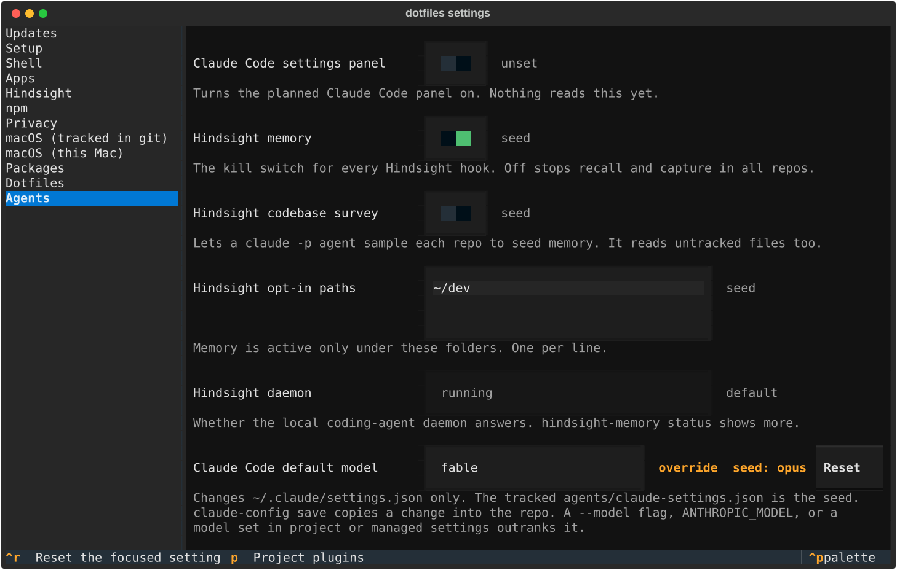

# dotfiles-settings

`dotfiles-settings` lists, reads, changes and resets the environment settings this repo manages. `registry.toml` names every setting. A change is stored in mise's override file, so it beats the export in `zsh/env.zsh`, `tilde/.zshenv` or `~/.zsh.local` without editing any of them.



There are three ways in:

- `dotfiles-settings tui` opens the terminal UI. Sections are on the left and the highlighted section's settings on the right. A row shows where its value comes from, and an overridden row has a **Reset** button (`ctrl+r` resets the focused row). `p` opens the plugin stack of the folder it was started from, with `k` to keep a plugin and `o` to turn one off.
- `dotfiles-settings serve` opens the same UI in a browser tab. `--no-open` prints the URL without opening it.
- `list`, `get`, `set`, `reset` and `apply` are for scripts, with `--json` on `list` and `get`.

```shell
dotfiles-settings list
dotfiles-settings get updates.slow_step_seconds --json
dotfiles-settings set setup.skip_codegraph on
dotfiles-settings reset setup.skip_codegraph
```

`bin/dotfiles-settings` is the launcher on PATH. It runs `uv run --locked --project "$DOTFILES/settings"`, so it uses the clone's code and lockfile, and an edit to `registry.toml` needs no reinstall. It runs from `$HOME`, because `uv` is often a mise shim, and a shim exits 1 in a folder that holds an untrusted `mise.toml`. `$DOTFILES` defaults to the clone the launcher sits in.

## Where a value comes from

Each value has one of four sources:

| Source | Meaning |
| --- | --- |
| `override` | Set with `dotfiles-settings set` (or `mise set --override`), stored in `config.override.toml` |
| `seed` | Exported by a new interactive zsh |
| `default` | Not exported anywhere, and the script that reads the variable falls back to the registry's `default` itself |
| `unset` | None of the above |

The seed is what a new interactive zsh exports from `zsh/env.zsh`, `tilde/.zshenv` and `~/.zsh.local`. A variable you exported by hand in one terminal is not a seed. To read the seeds, the package starts one `zsh -ic` with the override cache turned off (`DOTFILES_NO_OVERRIDE_ENV=1`) and the registry's variables removed from its environment. That zsh runs in its own session, because an interactive zsh on the terminal UI's terminal made every later keypress fail to read.

`set` writes `config.override.toml` in mise's config dir, `tilde/.config/mise/` inside the clone (`~/.config/mise` is a link to it). Git ignores the file. An override beats the seed, and `reset` removes the override, which hands the variable back to the seed. A change reaches each shell opened afterwards, through `zsh/override-env.zsh`. Shells that are already open keep the old value, and `set` and `reset` print `Open a new shell to pick this up.` to stderr to say so.

The VS Code font preset (`apps.vscode_font_preset`) is the one setting whose seed can come from a file. When no shell exports `VSCODE_FONT_PRESET`, the seed is the preset saved in `~/.config/dotfiles/vscode.env` by `vscode-settings --choose`. An override beats that saved preset without replacing it. Run `vscode-settings` in a new shell afterwards to render `settings.json`.

Some rows are read-only (`access = "ro"`). `set` and `reset` refuse them with exit 3, and the UIs draw them disabled:

- The telemetry opt-outs in the Privacy section. `zsh/env.zsh` and `setup.sh` keep that list in step (`.claude/rules/telemetry-sync.md`).
- The three Hindsight models (`HINDSIGHT_API_LLM_MODEL`, `HINDSIGHT_API_RETAIN_LLM_MODEL`, `HINDSIGHT_API_CONSOLIDATION_LLM_MODEL`). `tilde/.zshenv` sets them for shells and `agents/claude-settings.json` sets the same three for Claude Code, so an override would reach shells only. Change both files together.

The macOS preferences in the "macOS (tracked in git)" section are the `macos-default` kind. Their value is the one declared in `tilde/.config/mise/conf.d/20-macos.toml`, `seed` when it matches the committed file and `override` when it does not, and `drift` is true when the Mac's preference differs. `set` edits that one line of the tracked fragment in place and writes that one preference with `defaults write`. It never applies the whole fragment, so commit the file to keep the change. `reset` returns the line to the committed value. Applying every declared preference is `set-defaults`' job, which shows mise's planned writes and runs the extras script; `dotfiles-settings apply macos-default` has nothing to apply. The "macOS (this Mac)" switches are `env` settings that `setup/macos-extras.sh` reads at the next `set-defaults`.

The four rows in the Packages section are the `package` kind and are read-only. Each shows how many formulae, casks, VS Code extensions or mise tools are installed and names the ones that are not; the casks row also counts those Homebrew still manages. `dotfiles-settings apply package` installs what is missing (`mise bootstrap packages apply` per manager, then `mise install`). It never upgrades or prunes.

The rows in the Agents section are the `tool` kind, apart from `ui.claude_panel`, which is `env`. Each reads the tool's own file and writes through its CLI or one atomic edit of that file, so no value is copied: Hindsight's kill switch, survey and opt-in paths (`hindsight-memory`), the Claude Code default model (`~/.claude/settings.json`, with `agents/claude-settings.json` as the seed), one row per jstack role (`jstack-models.md`, a tracked file) and the read-only daemon and plugin stack rows. [`agents/README.md`](../agents/README.md) says what each change needs afterwards.

The one row in the Dotfiles section, `dotfiles.links`, is the `dotfile` kind and is read-only. It shows how many entries of `tilde/.config/mise/conf.d/40-dotfiles.toml` `mise dotfiles status` reports as applied and names each one that is not, with its state and reason. `dotfiles-settings apply dotfile` runs `mise dotfiles apply --yes` and never passes `--force`. A real file or folder in a target's place stops it with exit 1 and the paths, and nothing is changed. It makes links and copies only: the git identity, the `cot` and `code` links and the Firefox hard links come from `setup/dotfiles-extras.sh`.

## Commands and exit codes

| Command | Output | Exit |
| --- | --- | --- |
| `list [--section S] [--json]` | A JSON array, or one `id<TAB>value<TAB>source` line per setting | 0, 2 for an unknown section |
| `get <id> [--json]` | A JSON object, or the value alone (an empty line when unset) | 0, 2 for an unknown id |
| `set <id> <value>` | Nothing on stdout, the note on stderr | 0, 2 for an unknown id or an invalid value, 3 for a read-only setting |
| `reset <id>` | Nothing on stdout, the note on stderr | 0, 2 for an unknown id, 3 for a read-only setting |
| `apply <kind>` | The adapter's lines, or `<kind>: nothing to apply` | 0, 2 for an unknown kind |
| `tui` | Runs the terminal UI | 0 |
| `serve [--no-open]` | Prints the URL and serves the UI until you stop it | 0 |

In Claude Code, `set`, `reset` and `apply` ask first.

Exit 1 is any other failure: mise missing or older than 2026.11.5, an override file that is not valid TOML, a failed mise call. Every failure prints one `dotfiles-settings: <message>` line to stderr, with no traceback. `--section` matches the section name in any case. The `env` kind has nothing to apply.

A JSON object has these eleven keys:

| Key | Value |
| --- | --- |
| `setting_id` | The registry `id` |
| `value` | The current value, or `null` |
| `source` | `override`, `seed`, `default` or `unset` |
| `seed` | What `reset` would go back to, or `null` |
| `drift` | Whether the live system differs from the declared value. Always `false` for `env` |
| `label`, `section`, `type`, `access` | From the registry |
| `choices` | An array of strings, empty unless `type` is `enum` |
| `widget` | `""`, `"lines"` or `"seats"` |

```console
$ dotfiles-settings get updates.slow_step_seconds --json
{
  "setting_id": "updates.slow_step_seconds",
  "value": "10",
  "source": "default",
  "seed": "10",
  "drift": false,
  "label": "Show a step's time after this many seconds",
  "section": "Updates",
  "type": "int",
  "choices": [],
  "widget": "",
  "access": "rw"
}
```

## Values that are refused

`set` exits 2 and writes nothing when the value contains one of these, because mise would not store the typed value:

- `{{`, `{%` and `{#`. mise parses them as a Tera template, and a stored `{{ x }}` made every later `mise env` exit 1.
- `$`. mise expands `$VAR` and `${VAR}` when it prints the environment.
- A line break. `zsh/override-env.zsh` keeps only the first line of a value.

The value also has to fit the setting's type. An `int` is an optional `-` and digits, an `enum` is one of its `choices`, and a `path` is absolute after `~` is expanded. A `string` takes anything else.

## Booleans

A `bool` accepts `on`, `true`, `yes` or `1` for on, and `off`, `false`, `no` or `0` for off, in any case. On is stored as the setting's `true_value`, such as `1` or `true`. Off is stored as an empty value, which still beats a seed of `1`. The adapter receives `true_value` or `""`, never the word you typed. A row shows on when its value equals `true_value`.

## The browser UI

`serve` runs textual-serve on `127.0.0.1` only, on a random free port. The URL it prints carries a per-run token. The first request with the token sets a cookie and redirects to `/`, which takes the token out of the address bar. Every request needs that cookie, a `Host` of `127.0.0.1:<port>` and, when it sends one, a matching `Origin`. The WebSocket must send an `Origin`. Any other request gets 403, so another page open in the browser cannot drive the app.

The page makes no request outside `127.0.0.1`. `src/dotfiles_settings/templates/app_index.html` is textual-serve's page with its `fonts.googleapis.com` stylesheet link replaced by an `@font-face` on `RobotoMono-VariableFont_wght.ttf`, the font file textual-serve ships. `LICENSE-textual-serve` beside it is the license that copy carries.

After you upgrade textual-serve in `uv.lock`, `tests/test_serve.py` fails if upstream changed its template. To fix it:

1. Copy the new `textual_serve/templates/app_index.html` from `settings/.venv/lib/python3.*/site-packages/` over `src/dotfiles_settings/templates/app_index.html`.
1. Replace its Google Fonts `<link>` with the `@font-face` block, as `LOCAL_FONT` in `tests/test_serve.py` spells it.
1. Run `uv run --project settings python settings/tests/test_serve.py` again.

## Adding a setting

Add one `[[setting]]` table to `registry.toml`. These eight fields are required:

| Field | Value |
| --- | --- |
| `id` | Dotted lowercase, such as `setup.skip_codegraph` |
| `section` | The group the UI shows it under |
| `label` | The row's name |
| `help` | One or two sentences under the row |
| `kind` | The adapter, `env`, `macos-default`, `package`, `dotfile` or `tool` |
| `key` | For `env`, the variable name (`[A-Z_][A-Z0-9_]*`). For `macos-default`, `<domain>/<key>` |
| `type` | `bool`, `string`, `int`, `enum` or `path` |
| `access` | `rw` or `ro` |

These four are optional:

| Field | Default | Value |
| --- | --- | --- |
| `true_value` | `""` | What a `bool` stores for on. Required for a `bool` |
| `choices` | `[]` | The allowed values. Required for an `enum` |
| `default` | `""` | The fallback the consuming script applies itself. Nothing applies it for an `env` setting |
| `widget` | `""` | `""`, `"lines"` or `"seats"`. The UI draws every setting by its `type` for now |

The loader rejects a duplicate `id`, a missing or unknown field, a field of the wrong type, an unknown `kind`, `type` or `widget`, an `access` other than `rw` or `ro`, an `env` key that is not a variable name, a `bool` with no `true_value`, an `enum` with no `choices`, and a `default` outside `choices`.

To add a kind, write a module in `src/dotfiles_settings/adapters/` with `read`, `write` and `reset`, then add it to `ADAPTERS` in `adapters/__init__.py` and to `KINDS` in `registry.py`. An adapter can also define:

- `apply(self, settings)`, which returns the lines `apply <kind>` prints.
- `watch_paths(self)`, the files the terminal UI polls every two seconds, so a change made elsewhere shows up.
- `write_note`, a string or a method that takes the setting. `set` and `reset` print it after a write succeeds.

## Tests

One script per module lives in `settings/tests/`. Each is a plain script with module-level asserts that prints `ok`. The core tests use only the standard library, so any Python 3.11 or newer runs them:

```shell
python3 settings/tests/test_registry.py
```

The UI tests need Textual, so they run in the package's uv environment:

```shell
uv run --project settings python settings/tests/test_tui.py
```

`pnpm check` runs all of them. A core test is listed in `settings_tests` in `bin/lib/check`, and a Textual test goes in the uv block below it. A plan that adds registry entries asserts them in its own test file.

## Installing without the clone

```shell
uv tool install "git+https://github.com/jrmatherly/dotfiles#subdirectory=settings"
```

Use your fork's URL if you have one. The wheel carries its own copy of `registry.toml`.

## Requirements

- mise 2026.11.5 or newer. Below that, or with no mise on PATH, every command exits 1 with one line that names the floor.
- Python 3.11 or newer.
- uv. The first run of `bin/dotfiles-settings` creates `settings/.venv` and downloads Textual and textual-serve.
